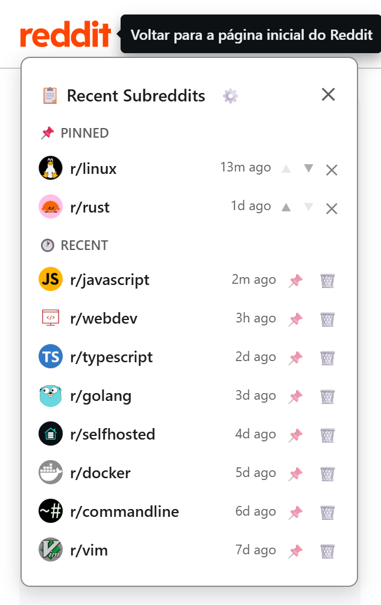
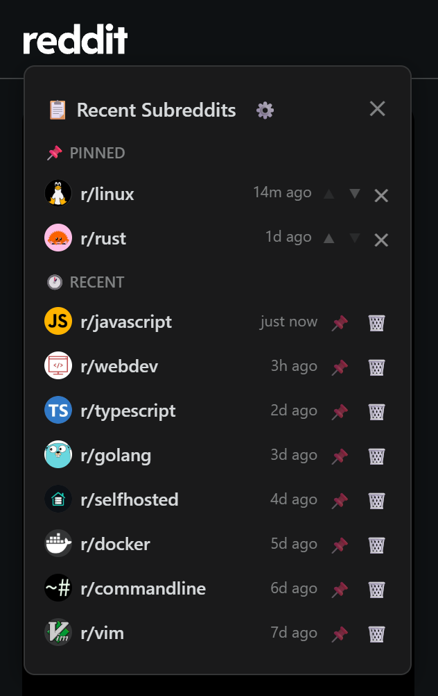

# Recent Subreddits Sidebar

A Tampermonkey userscript that lists your recently visited subreddits in a popup
anchored to Reddit's logo, with the ability to pin favorites for quick access.

| Light | Dark |
|-------|------|
|  |  |

Both shots are the real userscript on a real reddit page, opened by hovering the
logo. Regenerate them with `npm run screenshot` (see
[Development](#development)).

## Features

- Automatically tracks subreddits you visit (15 by default, configurable 1–200)
- Popup opens on hover or click of the Reddit logo / menu button, positioned
  relative to whichever element triggered it (flips above when there is no room below)
- Shows each subreddit's community icon
- Pin/unpin subreddits to keep them at the top
- Relative timestamps (e.g. "5m ago", "2h ago")
- Light and dark mode
- Configurable hotkey to open the popup (default `Alt+Shift+R`) — works even if
  Reddit changes its header markup and the hover triggers stop matching
- Warns in the console if no trigger selector matches, so a Reddit markup change
  is visible instead of silent
- Works on both new Reddit (www) and old Reddit
- Handles Reddit's single-page navigation — no page reload needed
- **Element picker**: hook any element on any site to open the popup, or render
  the list inline (replacing, prepending to, or appending to it) — not just the
  Reddit logo
- **Blocklist**: removed subreddits stay removed instead of reappearing on the
  next visit
- Data persists across sessions via Tampermonkey storage

## Installation

1. Install the [Tampermonkey](https://www.tampermonkey.net/) browser extension
2. Click the Tampermonkey icon → **Create a new script**
3. Delete the template code and paste the contents of `recent-subreddits.user.js`
4. Save (`Ctrl+S` / `Cmd+S`)
5. Visit any subreddit on Reddit — then hover the Reddit logo

## Usage

- **Hover** the Reddit logo (or menu button) to open the popup; **click** it to toggle
- **Pinned section**: subreddits you've pinned, always at the top
- **Recent section**: subreddits you've visited, most recent first
- **Pin button** (📌): Click to pin a subreddit — it moves to the Pinned section
- **Unpin button** (✕): Click to unpin — it returns to the Recent section
- **Trash button** (🗑): Click to remove a subreddit from history. It also adds the
  subreddit to the blocklist, so visiting it again will not put it back. There is
  no confirmation — un-block it in settings to let it return.
- Click any subreddit name to navigate to it
- Dismiss with the close button, a click outside, or `Escape`
- **⚙ Settings**: click the gear in the popup header to change the hotkey
- **Hotkey**: press `Alt+Shift+R` (or your configured combination) to open the
  popup from anywhere. It does not depend on any Reddit markup, so it still works
  when the hover trigger does not.
- **Blocked subreddits**: a settings section listing the blocklisted names, one per
  line, without the `r/`. The 🗑 button adds names here; deleting a line lets that
  subreddit be tracked again. The section is hidden until opened.
- **Hide row controls until hover**: a settings option that keeps each row's 📌 and
  🗑, and the header's ✕, invisible until you hover the row they belong to. Off by
  default.
- **Show timestamps**: a settings option that toggles the relative-time labels
  (e.g. "5m ago") next to each subreddit in the Recent and Pinned lists. On by
  default.
- **Recent history size**: a settings option for how many recently visited
  subreddits to keep (1–200, default 15). Pinned subreddits are always kept on
  top of this, so they never count against the limit. Lowering it prunes the
  stored history immediately.

The popup is sized to the space it has: it is capped to the room below (or above)
its trigger and scrolls internally when its content is taller, so it never runs off
the viewport. Opening Settings re-places it, since the panel is much taller than the
list, and the panel's Reset/Done row stays pinned to the bottom so the way out is
always reachable.

### When it breaks

There are two fragile points, and the script reports both in the console rather
than failing silently.

**The trigger selectors.** If Reddit changes its header, hover stops working:

```
[recent-subreddits] none of the configured hooks matched on this page (selectors: ...).
Hovering or clicking will not open the popup. Use the hotkey instead, and check the
Page targets in settings — Reddit may have changed its markup.
```

That warning names the selectors that failed. The hotkey keeps the feature usable
in the meantime, so a markup change degrades it rather than removing it.

**The icon harvest.** Subreddit icons come from the page itself, which costs no
request; the `about.json` fetch is only a fallback, and Reddit rate-limits it. If
the anchor that holds the icon is renamed, the harvest stops working:

```
[recent-subreddits] this page names a subreddit but has no #subreddit-icon-img anchor, so
its icon cannot be harvested. Icons will fall back to /r/<name>/about.json, which reddit
rate-limits — expect grey placeholders. Reddit may have changed its markup.
```

**The inline targets.** If a configured Page target selector matches nothing,
the block silently does not appear:

```
[recent-subreddits] inline target(s) matched nothing on this page (selectors: ...).
The block will not appear. Check the Page targets in settings — Reddit may have
changed its markup.
```

All three warnings fire at most once per page. The harvest warning only appears when
the page *names* a subreddit and has no icon — so old Reddit, the home feed, and
the moment mid-navigation when the icon is briefly the previous subreddit's all
stay quiet.

## Files

| File | Description |
|------|-------------|
| `recent-subreddits.user.js` | **Built artifact** — the userscript to install. Generated; do not edit by hand. |
| `src/` | Source modules (see below) |
| `scripts/build.mjs` | Bundles `src/` into the userscript |
| `scripts/screenshot.mjs` | Regenerates the README screenshots from a real reddit page |
| `docs/` | The README screenshots |
| `tests/unit/` | Fast unit tests (no browser) |
| `tests/e2e/` | Browser regression tests over CDP |
| `tests/e2e/fixture-server.mjs` | Serves the fixture on an ephemeral port, so it has a real origin |
| `tests/fixtures/reddit-mock.html` | Local Reddit stand-in that stubs the `GM_*` APIs |
| `LICENSE` | MIT |
| `README.md` | This file |

### Source layout

The userscript is one file by necessity (Tampermonkey installs a single script),
but it is written as modules and bundled:

| Module | Responsibility |
|--------|----------------|
| `src/userscript.meta.js` | The `==UserScript==` block. Prepended verbatim, not imported |
| `src/app.js` | The shell: mounting, popup visibility, event listeners, init |
| `src/storage.js` | Visit list, settings, the hook-target cache |
| `src/visits.js` | URL → subreddit, visit tracking, pin toggling |
| `src/content.js` | The recent/pinned list HTML |
| `src/settings-panel.js` | Settings view: hotkey capture, page-target list |
| `src/inline.js` | Inline instances (replace / prepend / append) |
| `src/picker.js` | The live element picker overlay |
| `src/selector.js` | Element → durable CSS selector |
| `src/triggers.js` | Does this event open the popup? |
| `src/icons.js` | Subreddit icon cache and fetch |
| `src/position.js` | Popup placement geometry |
| `src/hotkey.js` | Hotkey parse / match / capture |
| `src/diagnostics.js` | Console diagnostics for unmatched selectors and harvest failures |
| `src/styles.js` | The stylesheet |
| `src/time.js` | Relative timestamps |

Two modules (`settings-panel.js`, `inline.js`) call back into the shell, so they
receive an injected controller object rather than importing it — that is what
avoids an import cycle.

## Development

```bash
npm install      # dev tooling: esbuild, eslint, typescript

npm run build    # bundle src/ -> recent-subreddits.user.js
npm test         # unit tests (builds first; no browser needed)
npm run test:e2e # browser regression tests
npm run test:all # both suites
npm run lint     # eslint
npm run typecheck # tsc (checkJs, no emit)
npm run check    # lint + typecheck + both suites
npm run screenshot # regenerate docs/popup-{light,dark}.png (needs a real reddit session)
```

`npm test` rebuilds first via a `pretest` hook, so the committed userscript can
never drift from `src/`. The build is deterministic — rebuilding an unchanged
tree produces no diff.

The userscript's `@version` and `package.json`'s `version` are kept in step, and a
test fails if they drift: `@version` is what Tampermonkey compares to decide
whether to update, so a stale banner would silently stop updates.

### Continuous integration

`.github/workflows/ci.yml` runs on every push to `main` and every pull request,
and is the same gate as `npm run check`:

```bash
npm ci
npm run check    # lint + typecheck + unit + e2e
npm run build && git diff --exit-code   # the committed userscript matches src/
```

The second step is the artifact-freshness gate: because the userscript is
committed, a pull request could otherwise merge a build that no longer matches
`src/`. It passes on a fresh clone, where the build is byte-identical.

The ubuntu runner ships Chrome at `/usr/bin/google-chrome`, which `findBrowser()`
already probes, so the e2e suite really runs in CI rather than skipping for a
missing browser.

Known gaps and their reasoning are tracked in [TECH_DEBT.md](TECH_DEBT.md),
ordered by what to do first.

### Manual test against the real site

The automated suite runs against a local fixture, so it can only assert things
about markup we wrote ourselves. That is not enough: real Reddit has already
produced a bug the fixture could not see (a replace-mode block rendering at the
page origin instead of over its element).

```bash
npm run test:real           # headful browser, real www.reddit.com, you confirm each step
npm run test:real:offline   # same interactions against the local fixture
```

It opens a visible browser, drives the key interactions with a **real pointer**
(synthetic events bypass hit-testing, which is how "passes in tests, dead on the
site" bugs hide), and pauses at each step for you to answer `y` / `n` / `s`.
Geometry that can be measured is checked automatically and marked `[measured]`.

Notes:

- Live mode injects the userscript into reddit.com with the `GM_*` APIs stubbed,
  because a headful browser here has no userscript manager installed.
- Reddit may show "blocked by network security" on the first run. Solve it in the
  window once — the profile is persistent (`.manual-profile/`) so it stays solved.
- The browser closes itself if stdin is not interactive, so a piped run cannot
  leak a window. `Ctrl-C` also cleans up.
- The run prints its CDP port, so you can attach DevTools or a script while it is
  paused on a question.

The e2e suite loads the built userscript into `tests/fixtures/reddit-mock.html`,
which mimics the Reddit markup the script anchors to and stubs `GM_getValue`,
`GM_setValue` and `GM_xmlhttpRequest`. **It never contacts reddit.com**, so bot
protection and rate limits are not a factor; the icon data comes from the stub.

The fixture is **served** by `tests/e2e/fixture-server.mjs` on an ephemeral port
rather than opened as a `file://` page. That matters: a `file://` document has a
filesystem pathname, so `location.pathname` is never `/r/<name>/` and
`history.pushState` throws. Serving it gives the page a real origin, which is
what lets the suite drive visit tracking and Reddit's SPA navigation through the
real userscript. Every path serves the fixture (as Reddit serves its SPA shell
for every route), so a test can load `/r/javascript/` and get a genuine
subreddit view.

A Chromium is located automatically (Playwright's cache, then Chrome, then Edge).
Set `E2E_BROWSER` to point at a specific binary. **If no browser is found the e2e
suite skips rather than fails**, so `npm test` stays usable on a machine without one.

## Compatibility

- Chrome / Edge / Firefox / Safari (with Tampermonkey installed)
- Reddit new UI and old UI (`old.reddit.com`)

## License

MIT
